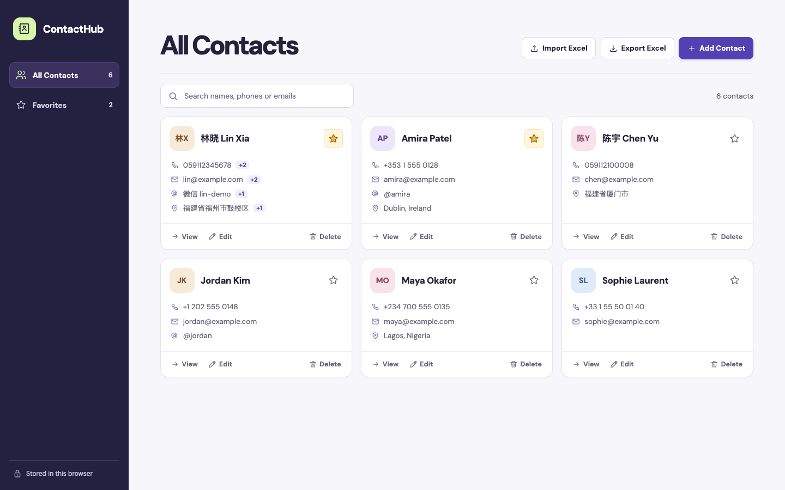
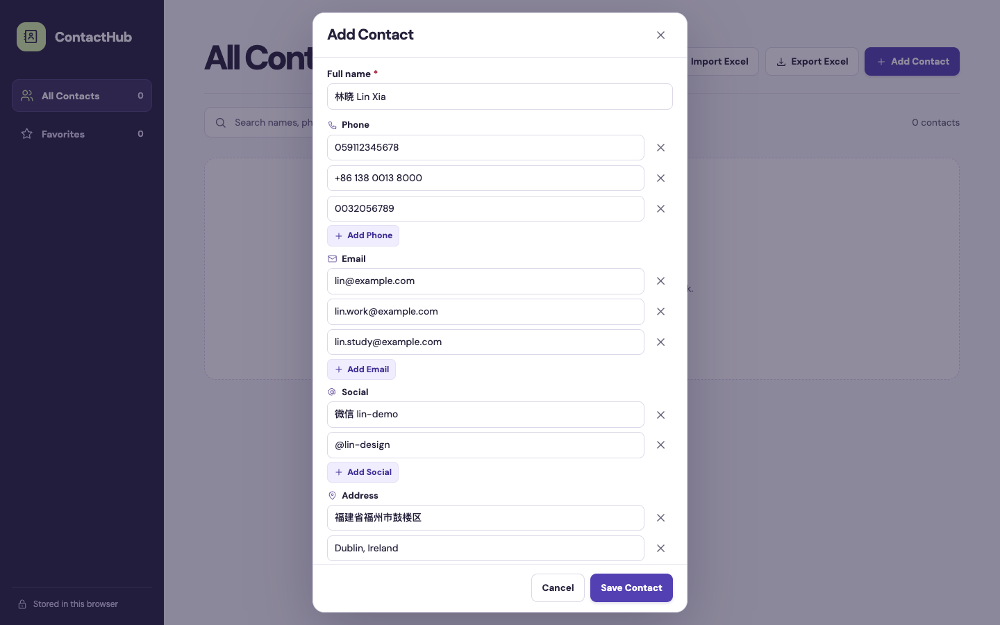
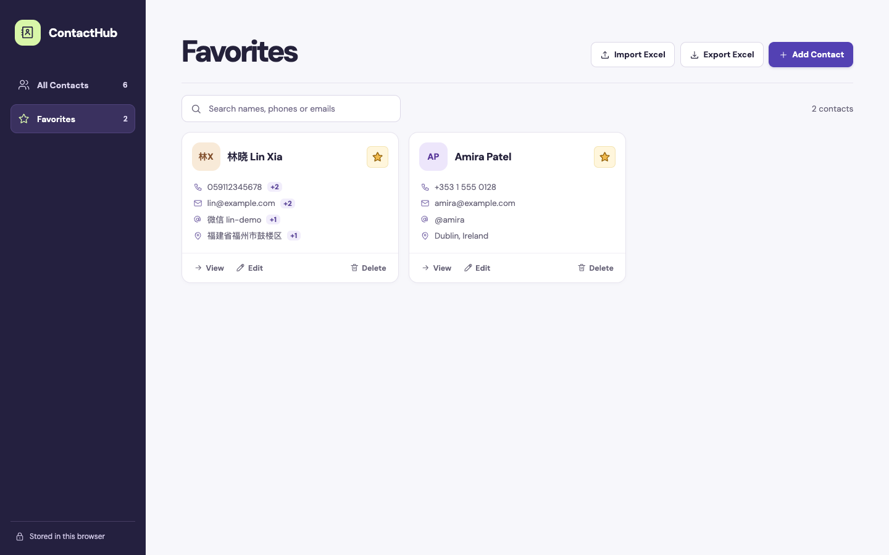
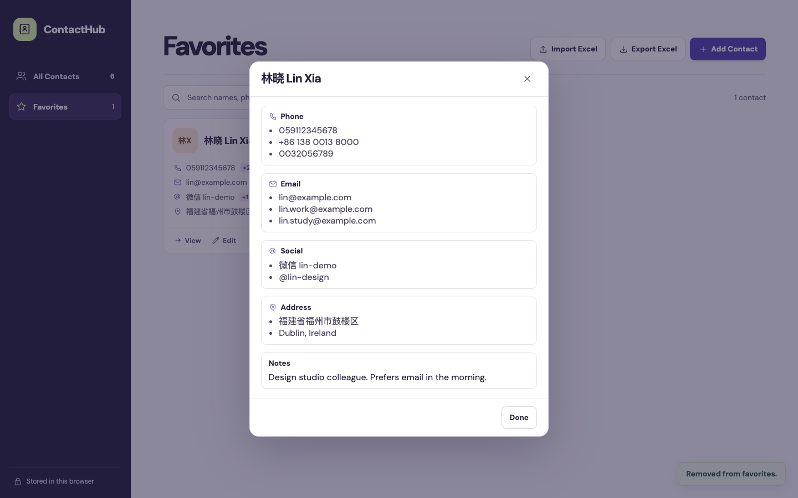
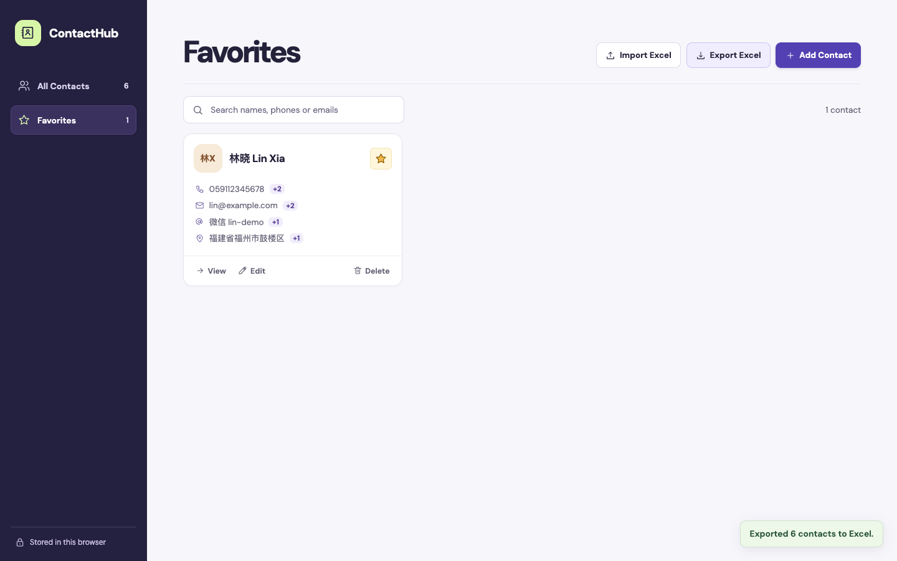
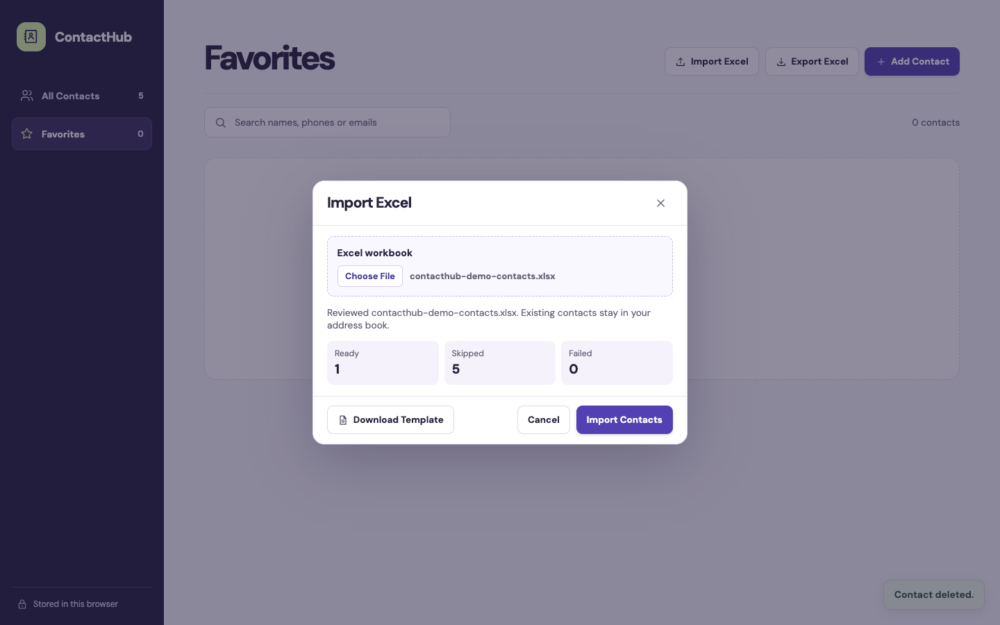

# Extreme Programming 实践作业：基于 Web 的通讯录系统设计与实现

| Item | Content |
| --- | --- |
| Course for This Assignment | Software Engineering (FZU–MU) |
| Team Name | TODO 填写个人项目或实际队名 |
| Assignment Requirements | 实现联系人收藏、多联系方式、Excel 导入和导出。交付可构建代码、GitHub 提交记录、版本与 PR，以及个人博客和 PSP |
| Objectives of This Assignment | 通过小步提交、模块化设计和可复现验收实践 Extreme Programming，理解页面、存储和数据交换之间的边界 |
| Other References | [作业原帖](https://bbs.csdn.net/topics/620593436) · [ContactHub 源码](https://github.com/yuhejiang929-cmd/ContactHub-Extreme-Programming) · [ExcelJS](https://github.com/exceljs/exceljs) |

## Table of Contents

1. [Project Overview](#1-project-overview)
2. [Requirements Analysis](#2-requirements-analysis)
3. [System Architecture](#3-system-architecture)
4. [Module Division](#4-module-division)
5. [Contact Data Model](#5-contact-data-model)
6. [Functional Implementation](#6-functional-implementation)
7. [Testing](#7-testing)
8. [Screenshots and Demonstration](#8-screenshots-and-demonstration)
9. [GitHub Repository and Commits](#9-github-repository-and-commits)
10. [Team Collaboration](#10-team-collaboration)
11. [PSP Table](#11-psp-table)
12. [Reflection and Conclusion](#12-reflection-and-conclusion)
13. [References](#13-references)

## 1. Project Overview

ContactHub 是一个浏览器内运行的通讯录。用户可以维护联系人、按姓名或联系方式查找、将高频联系人加入收藏，并借助 XLSX 在 Excel 和浏览器之间交换数据。页面采用卡片布局，包含 All Contacts 和 Favorites 两种视图。

## 2. Requirements Analysis

新增、查看、编辑、删除和搜索为三项作业功能提供入口。收藏应独立于编辑和搜索，同一人的多个电话或邮箱应能单独修改。Excel 按「一位联系人一行、不同信息分列」组织。开发分为联系人管理、收藏及动态表单、Excel 和验收四个节点，每个节点都有能验证的结果。

## 3. System Architecture

项目用 Vite 和原生 JavaScript 构建静态页面。用户操作由主入口转交模型和存储层，联系人数据写入浏览器 localStorage。ExcelJS 在用户开始导入或导出时按需加载。工作簿在浏览器内解析，可以通过真实文件验证往返。

## 4. Module Division

| 模块 | 文件 | 职责 |
| --- | --- | --- |
| 数据规则 | `src/contacts.js` | 字段校验、文本规范化、搜索、重复匹配 |
| 存储 | `src/storage.js` | 读写联系人列表，一次追加一批验证后的数据 |
| 页面与交互 | `index.html`、`src/main.js`、`src/ui.js`、`src/styles.css` | 两种视图、卡片、对话框、反馈和布局 |
| Excel | `src/excel.js`、`src/excel-ui.js` | 工作簿编解码、模板下载、预览和确认 |
| 验证与录制 | `tests/`、`scripts/capture-demo.js` | 单元测试、真实浏览器测试和演示 |

## 5. Contact Data Model

每条记录使用独立的 UUID 作 `id`，所以两位同名联系人可分别编辑和删除。`name` 为必填字符串，`phones`、`emails`、`socials`、`addresses` 为字符串数组，`isFavorite` 为布尔值，`notes` 可为空。号码以文本表示，支持保留前导零、空格和国际号码加号。

## 6. Functional Implementation

### 6.1 联系人管理

新增和编辑通过同一张表单收集字段，存储层依据 ID 更新。删除操作先展示确认对话框。搜索由 `findContacts` 派生列表，姓名和邮箱忽略大小写，电话支持按去除标点后的数字匹配。

### 6.2 收藏联系人

每张卡片上的星星对应 `isFavorite`。`toggleFavorite` 只反转此字段，Favorites 只显示已收藏的人。编辑时保留原收藏值，用户可在收藏视图直接取消收藏。

### 6.3 多联系方式

`renderMethodFields` 分别为四种类型生成动态输入行。使用 Add Phone 等按钮增加同类条目，逐行删除后重新标记序号。保存时 `normalizeContact` 去掉纯空白条目。卡片显示首条及额外条数，View 详情显示完整列表。

### 6.4 Excel 导出

`writeWorkbook` 用各类联系方式的最大长度生成 `Phone 1`、`Phone 2` 等列，为每位联系人写入一行。表头冻结，联系方式使用文本格式，Favorite 写为 Yes 或 No。导出入口读取完整存储列表，处于收藏或搜索视图时也导出全量数据。

### 6.5 Excel 导入

`readWorkbook` 检查文件大小、ZIP 目录和工作簿结构，然后按表头映射字段。编号用于排列同类联系方式，列顺序可以变化。空白行跳过，有效行进入预览，失败行带行号。公式字段会拒绝。确认时 `selectImportAdditions` 对比完整字段及重复份数，重复导入同一份文件时，已有份数计入 Skipped。

### 6.6 页面样式与持久化

桌面采用侧栏导航和响应式卡片，窄屏将导航放到顶部。键盘可进入表单及关闭对话框，星标通过实心状态和 `aria-pressed` 表达当前状态。写入成功后视图才更新，刷新读取当前浏览器保存的联系人，不同设备可以用 Excel 迁移。

## 7. Testing

| 验收范围 | 实际结果 |
| --- | --- |
| Vitest 联系人模型及 Excel 编解码 | 20 项通过 |
| Playwright 生产预览 Chrome 操作 | 4 项通过 |
| ESLint 和 Vite 生产构建 | 均成功 |
| XLSX 往返 | 中文、前导零、国际号码、同类多值和收藏状态一致 |
| 异常输入 | 无效文件保留已有联系人，有效行可经确认追加 |
| 移动布局 | 360 px 宽度无横向溢出，键盘能进入和退出对话框 |

测试中发现站点资源 404，添加图标后 Chrome 控制台检查通过，ZIP 校验依赖也更新到修复异常 ZIP64 问题的版本。更多用例和未验证范围见 [测试报告](https://github.com/yuhejiang929-cmd/ContactHub-Extreme-Programming/blob/main/docs/TEST_REPORT.md)。

## 8. Screenshots and Demonstration

以下截图来自真实应用会话。发布时上传图片并替换相对路径。

完整运行视频包含打开应用、新增、收藏和取消收藏、详情、导出、删除并导回、搜索、编辑和刷新。可上传 [本地 MP4](demo/contacthub-demo.mp4)。

**视频公开链接**　TODO 录制资产发布后填写。

## 9. GitHub Repository and Commits

| 项目 | 状态 |
| --- | --- |
| GitHub 仓库 | [ContactHub-Extreme-Programming](https://github.com/yuhejiang929-cmd/ContactHub-Extreme-Programming) |
| 代码规范 | [CODING_STANDARDS.md](https://github.com/yuhejiang929-cmd/ContactHub-Extreme-Programming/blob/main/docs/CODING_STANDARDS.md) |
| 功能分支 | `feature/extreme-programming-address-book` |
| Pull Request | [PR #1](https://github.com/yuhejiang929-cmd/ContactHub-Extreme-Programming/pull/1) |
| GitHub Release | TODO 待写入实测链接 |
| 云访问地址 | TODO 待写入实测链接 |

TODO 在发布前填入 [真实提交统计](GITHUB_EVIDENCE.md)，并上传真实 GitHub 提交历史截图。课程允许自建仓库。代码和文档由 Codex 协助实现，Git 作者记录同时用于说明本轮自动化开发和学生实际参与。

## 10. Team Collaboration

**个人项目**　TODO 确认个人作业后填写本人实际负责的任务、代码改动及复核结果，移除组队表。

**组队项目**　TODO 填写实际分工，贡献比例合计应为 100%。若为组队，移除个人描述。

| Member | Assigned Modules | Actual Work | Contribution Percentage |
| --- | --- | --- | ---: |
| TODO | TODO | TODO | TODO |
| TODO | TODO | TODO | TODO |
| **Total** |  |  | **100%** |

**Collaboration Difficulties and Solutions**　TODO 组队时填写真实遇到的问题、沟通过程和解决结果。

## 11. PSP Table

TODO 每位学生在自己的博客填写一张，实际用时根据本人记录计算。

| Phase | Estimated Time (min) | Actual Time (min) |
| --- | ---: | ---: |
| Planning |  |  |
| Design |  |  |
| Coding |  |  |
| Code Review |  |  |
| Testing |  |  |
| Documentation |  |  |
| Delivery |  |  |
| **Total** |  |  |

## 12. Reflection and Conclusion

动态编号列解决数组到工作簿的展开，数值顺序解析保证 `Phone 10` 位于 `Phone 2` 之后。在空白浏览器会话里导入下载的文件，能直接检验用户可否从备份还原。导入预览让同一个文件中的完整数据、重复项和错误行分别有反馈。

TODO 补充本人复核代码、修改用例或完成课程过程记录后的具体体会。

## 13. References

- 课程原始要求与提交入口。 [Extreme Programming 作业原帖](https://bbs.csdn.net/topics/620593436)
- 浏览器存储与构建。 [MDN localStorage](https://developer.mozilla.org/zh-CN/docs/Web/API/Window/localStorage) · [Vite](https://vite.dev/guide/)
- Excel 与测试。 [ExcelJS](https://github.com/exceljs/exceljs) · [Vitest](https://vitest.dev/guide/) · [Playwright](https://playwright.dev/docs/intro)
